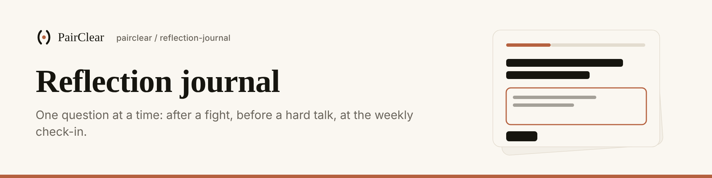
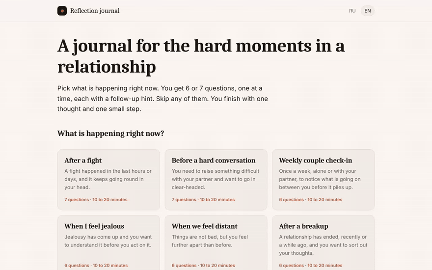
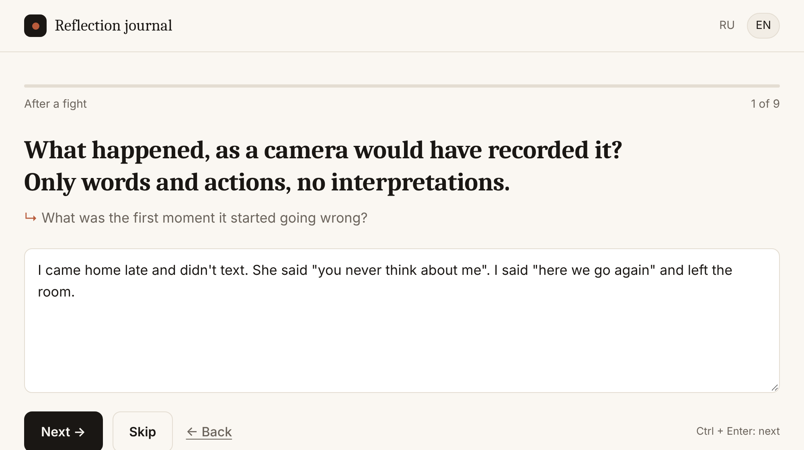

<a href="https://pairclear.github.io/reflection-journal/"><picture>
  <source media="(prefers-color-scheme: dark)" srcset="assets/banner-dark.png">
  
</picture></a>

# Relationship journal prompts: after a fight, before a hard conversation

**[Open the journal →](https://pairclear.github.io/reflection-journal/?lang=en)** · [Русская версия](README.ru.md) · [All questions](questions/en.md) · [ChatGPT prompt](prompts/chatgpt-en.md) · [Claude skill](SKILL.md)

    

> **Self-reflection, not diagnosis.** These questions are not a test, a diagnosis or therapy, and they do not replace a professional. If you are thinking about hurting yourself, are afraid of your partner, or there is violence at home, put the journal aside and call emergency services (112 in Europe, 911 in the US and Canada) or find a free helpline, including for domestic abuse, at [findahelpline.com](https://findahelpline.com).

## See it in action

**[Try it in your browser →](https://pairclear.github.io/reflection-journal/?lang=en)** No install, nothing is sent anywhere.

A small journal for the moments when something is going on between you and your partner. Pick the situation, answer 6 or 7 questions one at a time (each has a follow-up hint), skip what does not fit, and finish with one thought and one small step.

## Situations

| Situation | Use it when | Questions |
|---|---|---|
| [After a fight](questions/en.md#after-a-fight) | A fight is still going round in your head | 7 |
| [Before a hard conversation](questions/en.md#before-a-hard-talk) | You need to raise something difficult and want to go in clear-headed | 7 |
| [Weekly couple check-in](questions/en.md#weekly-check-in) | Once a week, alone or together, before things pile up | 6 |
| [When I feel jealous](questions/en.md#jealousy) | You want to understand the feeling before acting on it | 6 |
| [When we feel distant](questions/en.md#feeling-distant) | Nothing is wrong exactly, but you feel further apart | 6 |
| [After a breakup](questions/en.md#after-a-breakup) | You want to sort out your thoughts after it ended | 6 |

Every situation ends with the same two questions: one thought I take away, and one small step with a time.

## Four ways to use it

- **In the browser:** open [the journal](https://pairclear.github.io/reflection-journal/?lang=en). Entries stay in your browser; download them as Markdown or print them. Link straight to a situation with `?s=after-a-fight`.
- **On paper or in a notes app:** read [`questions/en.md`](questions/en.md), or copy a template from [`templates/en/`](templates/en/) into Obsidian, Notion, Bear or any Markdown app (`{{date}}` works with Obsidian's Templates plugin).
- **In a chat:** paste the prompt from [`prompts/chatgpt-en.md`](prompts/chatgpt-en.md) into ChatGPT, Claude or Gemini. It asks one question at a time and has rules against diagnosing you or labelling your partner.
- **As an agent skill:** [`SKILL.md`](SKILL.md) for Claude and other agents.

Already wrote an entry in the tool? Press "Prompt for ChatGPT or Claude" on the entry screen. It copies your answers with the same rules.

## How the questions are written

- Facts first, then interpretations: "What happened, as a camera would have recorded it?"
- Your side of the story: what you felt, told yourself, needed, and what your part was. Not blame.
- Your partner only through what they did and said. A guess about their feelings is marked as a guess, with a nudge to check it by asking.
- Requests, not charges: "I feel ... when ..., and I would like ..."
- Nothing helps you "diagnose" your partner, and nothing tells you to leave or stay.

These ideas come up often in work with couples. The questions themselves are ours, written with AI assistance. We know of no research that tested this particular set, so we make no claims about results.

## Privacy

The page makes no network requests, has no analytics, cookies or third-party fonts, and never sends what you write anywhere. Entries live in your browser's local storage until you delete them (one button erases everything). It is one readable file: check it yourself.

## FAQ

**Is this a test or therapy?** No. Nothing is scored and nobody is assessed. It is a set of questions to think with.

**Can we do it together?** The weekly check-in is made for it: each of you writes alone first, then you share only what you want to.

**My partner seems really toxic. Can this tell me if they are a narcissist?** No, and the chat prompt will not do it either. Labels for someone who is not in the room are guesses. The questions help you look at what they do, how it affects you, and what your options are. If you feel unsafe, that matters more than any journal: see the box at the top.

**Can I use it with clients?** You can share the link or the files. It is a reflection aid, not an assessment instrument.

**Why does a relationships site make this?** [PairClear](https://pairclear.com/en/?utm_source=github&utm_medium=readme&utm_campaign=reflection-journal) makes short quizzes about what is happening between two people, also computed in the browser. This journal is the quiet companion to them.

## Contributing

All texts live in [`data/prompts.json`](data/prompts.json). After editing it, run `node scripts/build.mjs` (no dependencies): it updates `index.html`, `questions/` and `templates/`. New languages are welcome; please keep the safety texts and the "no diagnosis, no labels" framing.

## More free tools from PairClear

| Repo | What it is |
|---|---|
| [16 associations](https://github.com/pairclear/sixteen-associations) | Write 16 words about one topic and merge them in pairs down to one |
| [Psychology lenses](https://github.com/pairclear/psychology-lenses) | One situation through Freud, Jung, CBT and 5 more schools |
| [Thoughts after a fight](https://github.com/pairclear/conflict-thought-diary) | A CBT thought diary for conflicts with a partner |
| [Not a therapist](https://github.com/pairclear/not-a-therapist) | Safety rules for AI chats about relationships |
| [Relationship questionnaires](https://github.com/pairclear/relationship-questionnaires) | Seven short open questionnaires, scored in your browser |
| [Couples counselling kit](https://github.com/pairclear/couples-counseling-kit) | Templates, homework and AI prompts for practitioners |

All tools and articles: [pairclear.com](https://pairclear.com/en/?utm_source=github&utm_medium=readme&utm_campaign=reflection-journal) · [github.com/pairclear](https://github.com/pairclear)

## Licence

Code: [MIT](LICENSE). Texts and prompts: [CC BY 4.0](LICENSE-TEXT.md). Texts were written with AI assistance.
