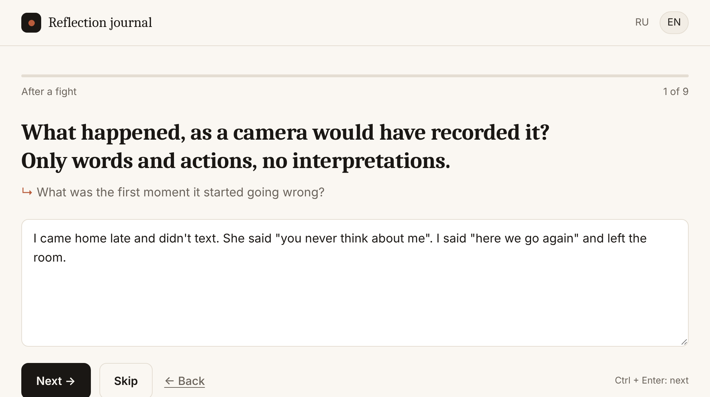

# Дневник отношений: вопросы после ссоры и перед трудным разговором

**[Открыть дневник →](https://pairclear.github.io/reflection-journal/?lang=ru)** · [English](README.md) · [Все вопросы](questions/ru.md) · [Промпт для ChatGPT](prompts/chatgpt-ru.md) · [Скилл для Claude](SKILL.md)

   

> **Саморефлексия, а не диагностика.** Эти вопросы не тест, не диагностика и не терапия и не заменяют специалиста. Если есть мысли навредить себе, ты боишься партнёра или дома есть насилие, отложи дневник и позвони в экстренную службу (112) или найди бесплатную линию поддержки, в том числе для пострадавших от домашнего насилия, на [findahelpline.com](https://findahelpline.com).

Небольшой дневник для моментов, когда между тобой и партнёром что-то происходит. Выбираешь ситуацию, отвечаешь на 6–7 вопросов по одному (у каждого есть подсказка), пропускаешь то, что не подходит, и заканчиваешь одной мыслью и одним маленьким шагом.

## Ситуации

| Ситуация | Когда подходит | Вопросов |
|---|---|---|
| [После ссоры](questions/ru.md#after-a-fight) | Ссора всё ещё крутится в голове | 7 |
| [Перед трудным разговором](questions/ru.md#before-a-hard-talk) | Нужно поднять трудную тему и подойти к ней с ясной головой | 7 |
| [Еженедельная сверка пары](questions/ru.md#weekly-check-in) | Раз в неделю, одному или вместе, пока ничего не накопилось | 6 |
| [Когда я ревную](questions/ru.md#jealousy) | Хочется понять чувство до того, как что-то делать | 6 |
| [Когда мы отдалились](questions/ru.md#feeling-distant) | Всё вроде не плохо, но вы дальше друг от друга | 6 |
| [После расставания](questions/ru.md#after-a-breakup) | Хочется разобраться в мыслях после того, как всё закончилось | 6 |

Каждая ситуация заканчивается двумя одинаковыми вопросами: одна мысль, которую я забираю, и один маленький шаг со сроком.

## Четыре способа

- **В браузере:** открой [дневник](https://pairclear.github.io/reflection-journal/?lang=ru). Записи хранятся в твоём браузере, их можно скачать в Markdown или распечатать. Сразу к ситуации: `?s=after-a-fight`.
- **На бумаге или в заметках:** прочитай [`questions/ru.md`](questions/ru.md) или возьми шаблон из [`templates/ru/`](templates/ru/) для Obsidian, Notion, Bear или любого Markdown-редактора (`{{date}}` работает с плагином Templates в Obsidian).
- **В чате:** вставь промпт из [`prompts/chatgpt-ru.md`](prompts/chatgpt-ru.md) в ChatGPT, Claude или Gemini. Он задаёт по одному вопросу и запрещает чату ставить тебе диагнозы и навешивать ярлыки на партнёра.
- **Как скилл агента:** [`SKILL.md`](SKILL.md) для Claude и других агентов.

Уже написал(а) запись в инструменте? Нажми «Промпт для ChatGPT или Claude» на экране записи. Скопируются твои ответы с теми же правилами.

## Как написаны вопросы

- Сначала факты, потом толкования: «Что произошло, как это записала бы камера?»
- Твоя сторона: что ты чувствовал(а), говорил(а) себе, что было нужно и какая твоя часть. Не вина.
- О партнёре только через его слова и действия. Догадка о его чувствах помечена как догадка, с предложением проверить её вопросом.
- Просьбы, а не обвинения: «Я чувствую ..., когда ..., и мне хотелось бы ...»
- Ничто здесь не помогает «поставить диагноз» партнёру и ничто не советует уйти или остаться.

Эти идеи часто встречаются в работе с парами. Сами вопросы наши, написаны с помощью ИИ. Исследований, которые проверяли бы именно этот набор, мы не знаем, поэтому ничего не обещаем.

## Приватность

Страница не делает сетевых запросов, в ней нет аналитики, cookies и сторонних шрифтов, и она никуда не отправляет то, что ты пишешь. Записи лежат в local storage браузера, пока ты их не удалишь (одна кнопка стирает всё). Это один читаемый файл: можно проверить.

## Вопросы и ответы

**Это тест или терапия?** Нет. Здесь ничего не считается и никто не оценивается. Это вопросы, с которыми можно подумать.

**Можно делать вдвоём?** Еженедельная сверка для этого и сделана: каждый сначала пишет сам, потом делитесь только тем, чем хочется.

**Мой партнёр, кажется, токсичный. Дневник скажет, нарцисс ли он?** Нет, и промпт для чата тоже не скажет. Ярлык для человека, которого нет в комнате, это догадка. Вопросы помогают посмотреть, что он делает, как это на тебя влияет и какие у тебя варианты. Если тебе небезопасно, это важнее любого дневника: смотри блок вверху.

**Можно давать клиентам?** Можно делиться ссылкой или файлами. Это инструмент для размышления, а не методика оценки.

**Почему это делает сайт про отношения?** [PairClear](https://pairclear.com/ru/?utm_source=github&utm_medium=readme&utm_campaign=reflection-journal) делает короткие тесты про то, что происходит между двумя людьми, тоже в браузере. Дневник их тихий спутник.

## Как помочь

Все тексты лежат в [`data/prompts.json`](data/prompts.json). После правки запусти `node scripts/build.mjs` (без зависимостей): он обновит `index.html`, `questions/` и `templates/`. Новые языки приветствуются; пожалуйста, сохраняй блоки безопасности и принцип «без диагнозов и ярлыков».

## Лицензия

Код: [MIT](LICENSE). Тексты и промпты: [CC BY 4.0](LICENSE-TEXT.md). Тексты написаны с помощью ИИ.
